  

### transmission

Building resilient backend architectures, scalable APIs, and full-stack systems. Focused on clean system integration, containerized workflows, and performance optimization.

### nodes (currently active)

- `n01` · `Invoi` — Invoicing & financial tracking engine built with Laravel, PostgreSQL, and Docker.
- `n02` · `Bayanuk` — High-performance backend services with rate-limiting, JWT authentication, and automated CI/CD pipelines.
- `n03` · `danah-portfolio` — Personal developer portfolio deployed via Cloudflare Pages.

### endpoints

[`danah-alsubaie.pages.dev`](https://danah-alsubaie.pages.dev) · [`LinkedIn`](https://linkedin.com/in/danah-alsubaie2) · [`Email`](mailto:danah.alsubaie2@gmail.com)
