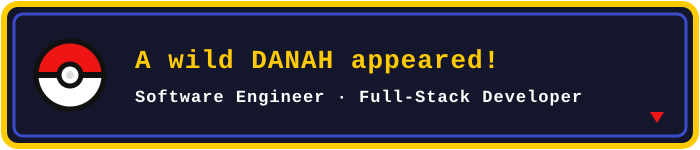

<h3 align="center">⚔️ MY PARTY</h3>

<h3 align="center">📕 POKÉDEX</h3>

<table align="center" width="500">
  <tr>
    <td width="33%" align="center" valign="top">
       
      <b>No. 001 BAYANUK</b> 
      <i>Laravel Backend</i> Laravel API · PostgreSQL · Docker + Jenkins  
      
    </td>
    <td width="33%" align="center" valign="top">
       
      <b>No. 002 INVOI</b> 
      <i>Full-Stack</i> Analytics page, frontend to backend  
      
    </td>
    <td width="33%" align="center" valign="top">
       
      <b>No. 003 REACHLY</b> 
      <i>Project</i>  
      
    </td>
  </tr>
</table>

<!-- Link each project to its repo once public, for example: https://github.com/CTRLD1/REPO_NAME -->

<h3 align="center">🎮 CATCH 'EM ALL</h3> 

Match the Pokémon in my memory game. How few moves can you do it in?

  

Gotta commit 'em all.
